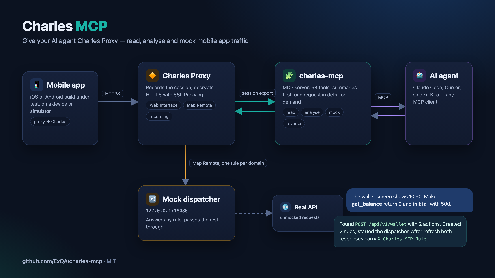
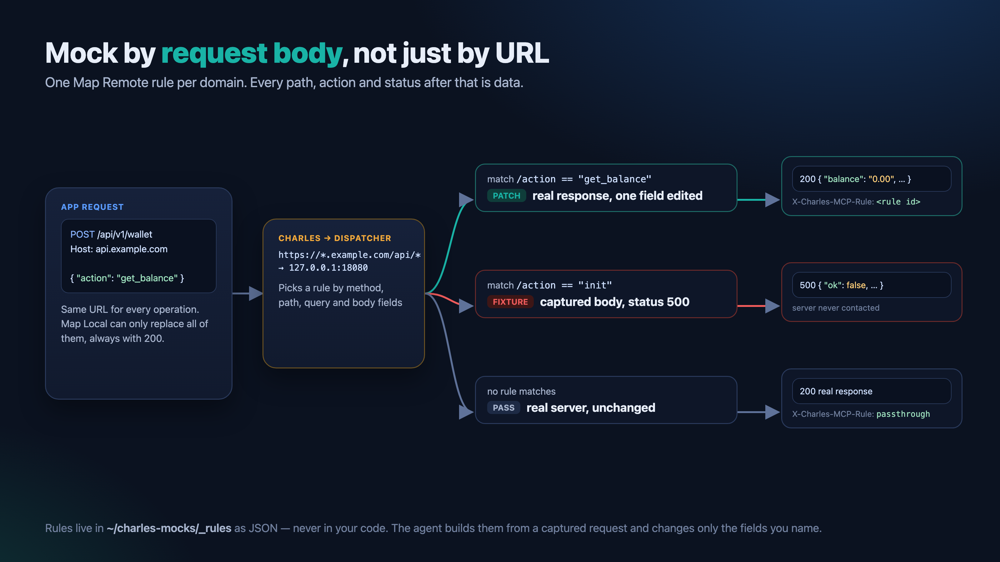
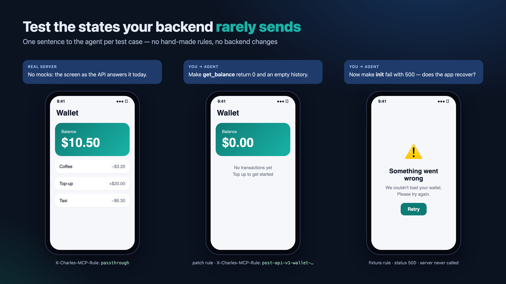
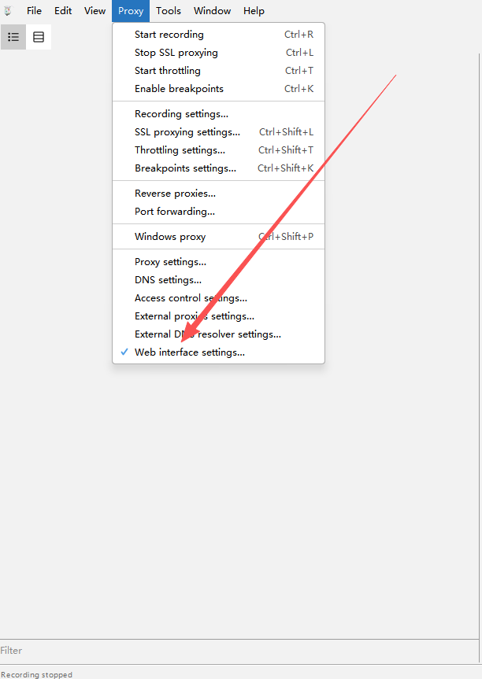
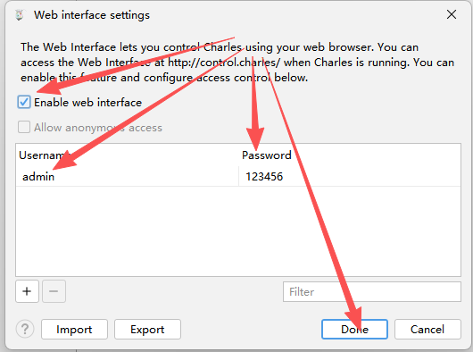

# Charles MCP Server

[](CHANGELOG.md)
[](LICENSE)
[](pyproject.toml)

[Ukrainian README](README.md) | [Docs](docs/README.md) | [Agent guide](docs/agent-guide.md) | [Mapping & Charles restarts](docs/charles-mapping.md) | [Tool Contract](docs/contracts/tools.md) | [AGENTS](AGENTS.md) | [Agent Workflow Guide](docs/agent-workflows.md) | [Team Installation](docs/team-installation.md)

**Give an AI agent access to Charles Proxy.** It finds the mobile app's requests on its own, explains what went wrong, and fakes responses for testing — no copying traffic into a chat, no hand-made rules in Charles.



## Why

Testing a mobile client through Charles is mostly chores:

- finding one request among hundreds and pasting it into a chat with an agent;
- changing one field of a response, while Map Local only knows "one file per URL": it cannot tell POST requests apart by an `action` in the body, and it always answers 200;
- checking an error screen, an empty state or a slow endpoint — and remembering to switch it all off afterwards.

`charles-mcp` is an MCP server that lets an agent (Claude Code, Cursor, Codex, Kiro and other MCP clients) do this itself: read the Charles session, find the request, build a mock from the real response changing only the fields you named, and check that the app received it.

## What it does

- **Reads traffic compactly.** The agent sees groups and short summaries first, not a raw dump, and opens one request only when it needs to. Works with the live session and with saved `.chlsj` recordings.
- **Fakes responses by request body.** A local dispatcher behind one Charles Map Remote rule tells requests apart by method, path, query and body fields (`{"action": "get_balance"}`). Either the real response with named fields edited, or a fixture with any status (500, 401) and delay.
- **Mocks are data, not code.** Rules and fixtures live in `~/charles-mocks`, outside any repository; Charles needs one rule per domain.
- **Reverse analysis.** Session import, body decoding (protobuf included), replay with changes, signature-field discovery.
- **Safe defaults.** It never clears the Charles session, never writes Charles's config while Charles runs, and switches off the Map Remote it switched on.

## How it works



The app talks to the network through Charles as usual. The server reads the Charles session through its Web Interface. For mocks, one Map Remote rule sends a domain's requests to a local dispatcher: it answers by rule (a fixture, or the real response with edits) and passes everything else to the real server unchanged. Every response carries an `X-Charles-MCP-Rule` header, so the agent checks the result against fresh traffic.

## Example



> **You:** The wallet screen shows a balance of 10.50. Make `get_balance` return 0 and `init` fail with 500.

The agent:

1. `start_live_capture` and `mock_discover_variants` — finds `POST /api/v1/wallet` with two `action` values, `init` and `get_balance`.
2. `mock_rule_create_from_entry` twice: for `get_balance` an edit of `/data/balance` in the real response, for `init` the captured response with status 500.
3. `mock_dispatcher(action="start")`; you refresh the screen.
4. `query_live_capture_entries(response_header_name="X-Charles-MCP-Rule")` — both responses came from the rules, every other request reached the server unchanged.

## Quick Start

### 1. Enable the Charles Web Interface

In Charles, open: `Proxy -> Web Interface Settings`

Make sure:

- `Enable web interface` is checked
- username is `admin`
- password is `123456`

> `admin` / `123456` are the defaults used in every example. For real work set your own
> password and pass it through `CHARLES_USER` / `CHARLES_PASS`.

Menu location:



Settings dialog:



Two more Charles settings, both made once:

- **Exclude the server's own requests from recording.** Open `Proxy -> Recording Settings -> Exclude`, press `Add` and set Host to `control.charles`, leaving the other fields empty. It takes effect at once, no restart. Every tool call exports the session through the Charles proxy; without this exclusion Charles records each export with the whole session as its body, so the session grows on every call (100 KB to 2 GB in one test run) and the tools slow to tens of seconds. The server warns with `charles_records_own_exports` when it sees this.
- **Enable SSL Proxying for the hosts you want to read.** Open `Proxy -> SSL Proxying Settings`, add the API host, and make sure the device trusts the Charles root certificate. Without it Charles records an HTTPS connection as one opaque tunnel, and the tools have no paths or bodies to show; they say so with an `ssl_proxying_off` warning.

### 2. Install and configure your MCP client

You need [uv](https://docs.astral.sh/uv/getting-started/installation/). Nothing to clone: `uvx` fetches the server from this repository, builds it once and caches it (uv brings its own Python if yours is older than 3.10). Check that it runs:

```bash
uvx --from git+https://github.com/ExQA/charles-mcp charles-mcp --selftest
```

It prints the version and the tool counts and ends with `OK`.

> Do not install `charles-mcp` from PyPI (`uvx charles-mcp`, `pip install charles-mcp`): that package is a different, older project (upstream 3.0.3) without the mock tools.

#### Claude Code plugin (server and skill)

In Claude Code:

```text
/plugin install charles-mcp --marketplace ExQA/charles-mcp
```

On Claude Code older than 2.1.275, run `/plugin marketplace add ExQA/charles-mcp` and then `/plugin install charles-mcp@charles-mcp`. The plugin asks for your Charles Web Interface user and password (the password goes to the system keychain), adds the server and the `charles-proxy-qa` skill that tells Claude when to reach for Charles and in which order to call the tools. Change the credentials later with `/plugin configure charles-mcp@charles-mcp`.

#### Claude Code CLI (server only)

```bash
claude mcp add charles --scope user \
  -e CHARLES_USER=your-login -e CHARLES_PASS=your-password -e CHARLES_MANAGE_LIFECYCLE=false \
  -- uvx --from git+https://github.com/ExQA/charles-mcp charles-mcp
```

#### Claude Desktop / Cursor / Kiro / generic JSON config

```json
{
  "mcpServers": {
    "charles": {
      "command": "uvx",
      "args": ["--from", "git+https://github.com/ExQA/charles-mcp", "charles-mcp"],
      "env": {
        "CHARLES_USER": "your-login",
        "CHARLES_PASS": "your-password",
        "CHARLES_MANAGE_LIFECYCLE": "false"
      }
    }
  }
}
```

Desktop apps do not always see the `PATH` of your shell: if the server does not start, put the full path from `which uvx` into `command`. Kiro reads `.kiro/settings/mcp.json` in the project (it wins) or `~/.kiro/settings/mcp.json`.

#### Codex CLI

```toml
[mcp_servers.charles]
command = "uvx"
args = ["--from", "git+https://github.com/ExQA/charles-mcp", "charles-mcp"]

[mcp_servers.charles.env]
CHARLES_USER = "your-login"
CHARLES_PASS = "your-password"
CHARLES_MANAGE_LIFECYCLE = "false"
```

#### The skill in other agents

[`plugin/skills/charles-proxy-qa`](plugin/skills/charles-proxy-qa/SKILL.md) is a standard `SKILL.md` skill: copy the folder to where your agent loads skills from (for Codex, `~/.codex/skills/`). It works next to any of the configs above.

#### Updating and pinning

`uvx` keeps the build it made. To take the newest version, run the check with `--refresh` and restart the agent:

```bash
uvx --refresh --from git+https://github.com/ExQA/charles-mcp charles-mcp --selftest
```

To stay on one release, pin it in every config: `git+https://github.com/ExQA/charles-mcp@v3.1.0rc2`.

### From a source checkout or offline

For development, or to run exactly the locked dependencies:

```bash
git clone https://github.com/ExQA/charles-mcp.git
cd charles-mcp && uv sync --locked
uv run charles-mcp --selftest
```

In the configs above replace `uvx` and its arguments with `"command": "uv"`, `"args": ["run", "--project", "<PATH>", "charles-mcp"]`, where `<PATH>` is the absolute path of the checkout. For machines without network access there is an offline archive that carries its dependencies: [docs/team-installation.md](docs/team-installation.md).

### Auto-install via AI agent

For a local checkout or the offline archive, give your agent the prompt in [INSTALL-PROMPT.md](INSTALL-PROMPT.md). It installs from the folder, checks the build with `--selftest` and adds the server to your MCP client config without touching the other servers there.

## Requirements

- [uv](https://docs.astral.sh/uv/) (it brings Python 3.10+ when yours is older)
- Charles Proxy running locally
- Charles Web Interface enabled
- Charles proxy listening on `127.0.0.1:8888`

`CHARLES_MANAGE_LIFECYCLE=false` is the recommended default. Unless you explicitly want the MCP server to manage Charles lifecycle, do not let it shut down your own Charles process.

## Environment Variables

| Variable | Default | Purpose |
| --- | --- | --- |
| `CHARLES_USER` | `admin` | Charles Web Interface username |
| `CHARLES_PASS` | `123456` | Charles Web Interface password |
| `CHARLES_PROXY_HOST` | `127.0.0.1` | Charles proxy host |
| `CHARLES_PROXY_PORT` | `8888` | Charles proxy port |
| `CHARLES_CONFIG_PATH` | auto-detect | Charles config file path |
| `CHARLES_REQUEST_TIMEOUT` | `10` | Control-plane HTTP timeout in seconds |
| `CHARLES_MANAGE_LIFECYCLE` | `false` | Whether the MCP server should manage Charles startup and shutdown |
| `CHARLES_RETENTION_DAYS` | `0` | Days to keep saved captures, reverse-analysis data and config backups; older ones are purged when the server starts. `0` disables it |
| `CHARLES_REVERSE_STATE_DIR` | `${CHARLES_STATE_DIR}/reverse` | State root for reverse-analysis artifacts and SQLite data |
| `CHARLES_MOCK_DIR` | `~/charles-mocks` | Root of the Map Local mock store; Charles maps `https://<host>/*` to `<CHARLES_MOCK_DIR>/<host>/`. Dispatcher rules live in `<CHARLES_MOCK_DIR>/_rules/` |
| `CHARLES_DISPATCHER_PORT` | `18080` | Port of the local body-aware dispatcher that Map Remote routes point to |
| `CHARLES_DISPATCHER_TIMEOUT` | `20` | Upstream timeout in seconds for requests the dispatcher forwards |

## Recommended Flows

### Live analysis

1. `start_live_capture`
2. `group_capture_analysis`
3. `query_live_capture_entries`
4. `get_traffic_entry_detail`
5. `stop_live_capture`

This path is optimized for finding hotspots first, then drilling down into one confirmed request.

### History analysis

1. `list_recordings`
2. `analyze_recorded_traffic`
3. `group_capture_analysis(source="history")`
4. `get_traffic_entry_detail`

This path is optimized for browsing saved recordings and then drilling into selected entries.

### Mocking responses with Map Local

> How the Charles rules work, when and how Charles is restarted, rollback and troubleshooting: [docs/charles-mapping.md](docs/charles-mapping.md).

1. `mock_setup_host` once per host: creates `<CHARLES_MOCK_DIR>/<host>/` and the Charles rules. With `apply=true` (Charles must be closed) it writes them into the Charles config; otherwise it returns manual steps.
2. `start_live_capture` + `query_live_capture_entries` to find the real response.
3. `mock_create_from_entry` with JSON Pointer `patches` (or `mock_write` for a response from scratch).
4. The app repeats the request; confirm with `query_live_capture_entries(response_header_name="X-Charles-Map-Local")`.
5. `mock_remove` to go back to the real server (the file is archived, not deleted); `mock_set_enabled(false)` pauses all mocks.

A mock is just a file at `<CHARLES_MOCK_DIR>/<host>/<request path>`: Charles serves it while it exists, re-reads it on every request, and passes the request through when it does not. Map Local limits: the response status is always 200, and the query string and HTTP method are ignored, so every variant of a path gets the same file. `/users` and `/users/42` cannot both be mocked, because `users` cannot be a file and a directory at once. The setup also adds a Rewrite rule that serves mocks as `application/json`, since Charles labels extension-less files `text/plain`.

### Many paths and actions: dispatcher rules

Use this for real API traffic: many paths, POST requests whose `action` field selects the operation, and the same API on several hosts (dev, stage, ...). Map Local cannot tell such requests apart; the dispatcher can. See [ADR-0001](docs/adr/0001-data-driven-body-aware-mocks.md) for the reasoning.

> The Charles rule is set up once per domain and needs a Charles restart (or manual entry in the UI, no restart). The tools never quit or start Charles themselves: the order of steps, what is lost and how to roll back are in [docs/charles-mapping.md](docs/charles-mapping.md).

**Once per domain.** `mock_route_setup(host="*.example.com", path="/api/*")` records the route and returns one Charles Map Remote mapping: `https://*.example.com/api/*` to the local dispatcher with an empty destination path (Charles keeps the original path) and "Preserve host header" on. `apply=true` writes it while Charles is closed. After that, every path, action and host under the route is only data, and requests without a rule go to the real server unchanged.

**Per session.**

1. `start_live_capture`, then let the app run the flow.
2. `mock_discover_variants(source="live", capture_id)` lists the whole session: method × host × path × `action` value (`null` for GETs), with counts, sample `entry_id`s and statuses. Filter with `host_contains` / `path_contains`.
3. For each change the user asks for: `mock_rule_create_from_entry(entry_id, match_body_fields=["/action"], response_patches=[...], request_patches=[...])`.
   - `mode="patch"` (default): the real server answers; only the named fields of the request and response change.
   - `mode="fixture"`: the captured response with patches and any `status`, e.g. 500, without contacting the server.
   - Rules apply on every routed host by default (`host_scope="any"`); `host_scope="exact"` or `host="stage.example.com"` narrows one, and an exact-host rule wins over a general one.
   - Asking again for the same variant adds to its rule (`merge=true`); a patch on the same field replaces the earlier one.
4. `mock_dispatcher(action="start")`, then repeat the actions in the app.
5. Confirm with `query_live_capture_entries(response_header_name="X-Charles-MCP-Rule")`: the header carries the rule id, or `passthrough`.

Storage in `<CHARLES_MOCK_DIR>/_rules/`: `routes.json` (routes), `_any/` (rules for any host or a host glob), `<host>/` (rules for one host), fixtures next to their rules as `<rule_id>.body`. The dispatcher re-reads them on every request, so edits apply immediately. It only forwards requests covered by a route, listens on `127.0.0.1` and must run while the Charles mapping is active; for a long-running instance run `uvx --from git+https://github.com/ExQA/charles-mcp charles-mcp-dispatcher --port 18080` in a terminal. Routing a whole host (`/*`) also sends its static files and WebSocket upgrades through the dispatcher, which buffers downloads and does not support WebSockets; prefer the API prefix.

> ⚠️ Fixtures are captured real responses and can contain personal or payment data. Keep `CHARLES_MOCK_DIR` outside any repository and never share it; share rule definitions with synthetic data instead.

## Tool Catalog

This README documents the whole public tool surface.

### Live capture tools

| Tool | What it does | Typical use |
| --- | --- | --- |
| `start_live_capture` | Starts or adopts the current live capture and returns `capture_id`; never clears the traffic Charles already recorded and always includes it in the capture | Before realtime inspection begins |
| `read_live_capture` | Reads incremental live entries by cursor and returns compact route summaries only | When consuming new traffic continuously and you only need host/path/status first |
| `peek_live_capture` | Previews new live entries without advancing the cursor and returns compact route summaries only | When you want to inspect new traffic without moving the reader state |
| `stop_live_capture` | Stops the capture and optionally persists a snapshot | When closing or exporting a live session |
| `query_live_capture_entries` | Produces structured summary output for a live capture without advancing the cursor | When repeatedly filtering high-value requests out of current traffic |

### Analysis tools

| Tool | What it does | Typical use |
| --- | --- | --- |
| `group_capture_analysis` | Aggregates live or history traffic by group key | When you want the lowest-token hotspot view |
| `get_capture_analysis_stats` | Returns coarse traffic class counts | When you want a quick distribution view |
| `get_traffic_entry_detail` | Loads detail for one specific entry and warns when the payload is too large | After you already identified a target `entry_id` |
| `analyze_recorded_traffic` | Produces structured summary output for a saved recording with match reasons | When analyzing a `.chlsj` snapshot |

### History tools

| Tool | What it does | Typical use |
| --- | --- | --- |
| `list_recordings` | Lists saved recording files | Before choosing a historical snapshot |
| `get_recording_snapshot` | Lists one saved recording as compact summaries, a page at a time, without bodies | When you need to see what a stored snapshot holds |
| `query_recorded_traffic` | Applies lightweight filtering to the latest saved recording | When you need a quick host, method, or regex query |

### Status and control tools

| Tool | What it does | Typical use |
| --- | --- | --- |
| `charles_status` | Reports Charles connectivity and active capture state | When checking whether Charles is reachable or capture is still active |
| `throttling` | Applies a Charles network throttling preset | When simulating 3G, 4G, 5G, or disabling throttling |
| `reset_environment` | Restores Charles configuration and clears the current environment | When you need to return to a clean baseline |
| `charles_recording_exclude` | Adds a host (default `control.charles`) to Proxy → Recording Settings → Exclude: returns the UI steps, or writes the config with `apply=true` while Charles is closed | Once per setup, so Charles stops recording this server's own exports |
| `charles_config_summary` | Reads the Charles config file without its secrets: Map Remote and Map Local mappings with their problems, SSL Proxying hosts, recording excludes, Rewrite set names, Web Interface state | When a mapping does not fire or traffic stays encrypted, instead of opening the config file |
| `purge_stored_data` | Deletes saved captures, reverse-analysis data and config backups older than a cut-off; `dry_run=true` by default | To clear stored traffic |

### Reverse analysis tools

| Tool | What it does | Typical use |
| --- | --- | --- |
| `reverse_import_session` | Imports an official Charles XML or native session into the canonical reverse store | When starting a replay, decode, or signature workflow from saved exports |
| `reverse_list_captures` | Lists imported reverse-analysis captures | When choosing a capture already stored in the reverse SQLite plane |
| `reverse_query_entries` | Filters imported reverse entries by route fields | When narrowing the candidate request set before detail or replay |
| `reverse_get_entry_detail` | Returns canonical detail for one imported reverse entry | When inspecting one baseline request deeply |
| `reverse_decode_entry_body` | Decodes a stored request or response body, including protobuf with descriptors | When you need structured payload understanding |
| `reverse_replay_entry` | Replays one imported request with optional mutations | When validating whether a request can be reproduced or perturbed |
| `reverse_discover_signature_candidates` | Compares multiple imported entries and ranks likely signature-related fields | When searching for dynamic auth or signing parameters |
| `reverse_list_findings` | Lists persisted replay and signature findings | When reviewing prior reverse-analysis evidence |
| `reverse_charles_recording_status` | Reports Charles recording state and reverse live-session state | When checking live reverse-analysis readiness |
| `reverse_start_live_analysis` | Starts a reverse-analysis live session and snapshots Charles via official export pages | When reverse work must track fresh traffic incrementally |
| `reverse_peek_live_entries` | Reads new reverse live entries without advancing the reverse cursor | When previewing new traffic before consuming it |
| `reverse_read_live_entries` | Reads and consumes new reverse live entries | When advancing a reverse live-analysis session |
| `reverse_stop_live_analysis` | Stops a reverse live-analysis session and optionally restores recording | When closing a reverse live session cleanly |
| `reverse_analyze_live_login_flow` | Scores new live traffic for login/auth relevance and summarizes next actions | When tracing login or token bootstrap flows |
| `reverse_analyze_live_api_flow` | Scores new live traffic for API workflow relevance and summarizes next actions | When tracing structured business API traffic |
| `reverse_analyze_live_signature_flow` | Focuses new live traffic on signature-sensitive requests and mutation planning | When targeting signing, nonce, or timestamp defenses |

### Map Local mock tools

| Tool | What it does | Typical use |
| --- | --- | --- |
| `mock_setup_host` | Creates the host's mock directory and the Map Local + Rewrite rules (manual steps, or written to the config with `apply=true` while Charles is closed) | Once per API host |
| `mock_create_from_entry` | Turns a captured response into a mock, applying JSON Pointer edits | When the user wants to change data the app received |
| `mock_write` | Writes a mock from a JSON value or raw text | When no real response exists yet |
| `mock_list` / `mock_get` | Lists active mocks / shows one | When reviewing what is currently mocked |
| `mock_remove` | Archives a mock so the path hits the real server again | When a scenario is finished |
| `mock_set_enabled` | Turns the whole Map Local tool on or off via the web interface | When pausing or resuming all mocks |

### Dispatcher rule tools

| Tool | What it does | Typical use |
| --- | --- | --- |
| `mock_route_setup` | Routes a host or domain glob (default every path) through the dispatcher and returns (or, with `apply=true` while Charles is closed, writes) the one Map Remote mapping | Once per domain |
| `mock_discover_variants` | Groups the whole session by method, host, path and a body field such as `/action` | Right after reading a session |
| `mock_rule_create_from_entry` | Creates or extends the rule for one variant (method + path + body/query values): patch or fixture mode, any status, any host by default | For each change the user names |
| `mock_rule_write` | Writes a rule document directly, optionally with a fixture | When no captured request exists |
| `mock_rule_list` / `mock_rule_get` | Lists routes and rules / shows one rule and its fixture | When reviewing what is mocked |
| `mock_rule_set_enabled` / `mock_rule_remove` | Pauses a rule / archives it | When a scenario is finished |
| `mock_dispatcher` | Starts, stops or checks the local dispatcher; start/stop also switch Charles Map Remote on/off so routed traffic never hits a stopped dispatcher | Before testing, and when done |
| `mock_scenario_save` / `mock_scenario_apply` | Names a set of rules (a whole QA flow such as "payment fails after login") and switches it on in one call; `exclusive` turns every other rule off | To switch between test flows without leftovers |
| `mock_scenario_list` / `mock_scenario_remove` | Lists scenarios and whether they are fully active / removes one without touching its rules | To see or tidy saved flows |

## Key Behavior

### 1. Raw values are returned by default

This version no longer redacts request or response content:

- summary, detail, live, and history outputs all return raw values

### 2. Summary comes before detail

Use `group_capture_analysis`, `query_live_capture_entries`, or `analyze_recorded_traffic` first, then call `get_traffic_entry_detail` only for a confirmed target.

Do not default to `include_full_body=true` unless there is a clear reason.

### 3. Output is optimized for token budgets

All summary and detail outputs have been serialized lean:

- Internal fields like `header_map`, `parsed_json`, `parsed_form`, and `lower_name` are excluded from tool output
- `null` values are stripped automatically during serialization
- When `full_text` is present in a detail view, the redundant `preview_text` is removed

Defaults are small to protect the context window:

| Parameter | Default |
| --- | --- |
| `max_items` | 10 |
| `max_preview_chars` | 128 |
| `max_headers_per_side` | 6 |
| `max_body_chars` | 2048 |

Higher values can still be passed explicitly when a wider view is needed.

### 4. History detail needs stable source identity

History summaries return `recording_path`. Live summaries return `capture_id`.

For `get_traffic_entry_detail`:

- prefer `recording_path` for history
- prefer `capture_id` for live

### 5. `stop_live_capture` failures are recoverable

`stop_live_capture` has two stable end states:

- `status="stopped"` means the capture is actually closed
- `status="stop_failed"` means a short retry also failed but the capture is still preserved

When the result is:

```json
{
  "status": "stop_failed",
  "recoverable": true,
  "active_capture_preserved": true
}
```

the capture is still readable and can be diagnosed or stopped again later.

## Development

Run tests:

```bash
python -m pytest -q
```

Useful local checks:

```bash
python charles-mcp-server.py
python -c "from charles_mcp.main import main; main()"
```

## Origin

This is a fork of [heizaheiza/Charles-mcp](https://github.com/heizaheiza/Charles-mcp) (MIT). The fork adds response mocking (Map Local and a rule dispatcher), handling of long sessions and the fixes listed in [CHANGELOG.md](CHANGELOG.md). Details in [PROVENANCE.md](PROVENANCE.md).

## See Also

- [Docs](docs/README.md)
- [Ukrainian README](README.md)
- [Tool Contract](docs/contracts/tools.md)
